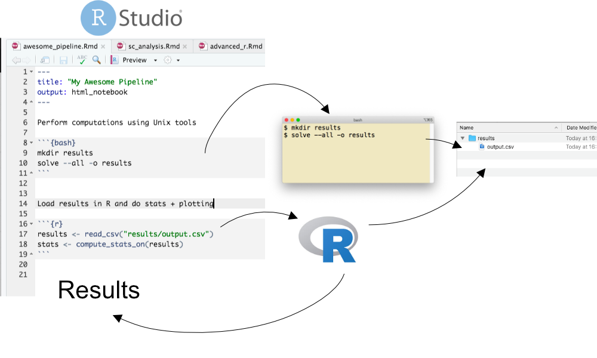
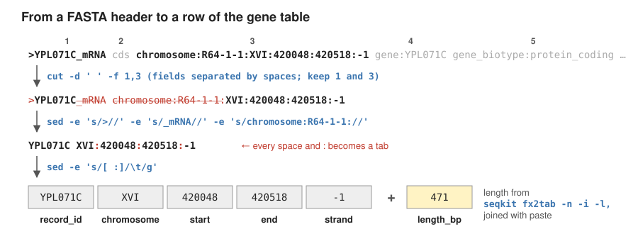
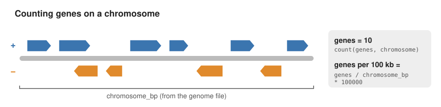
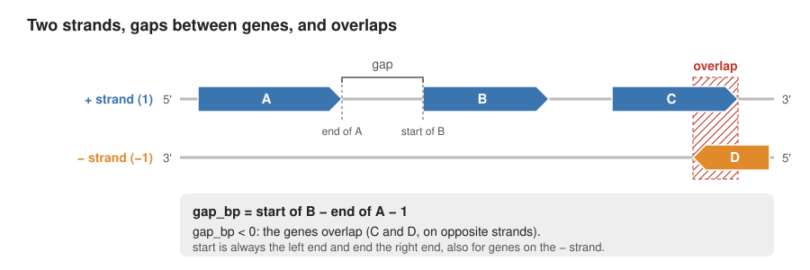
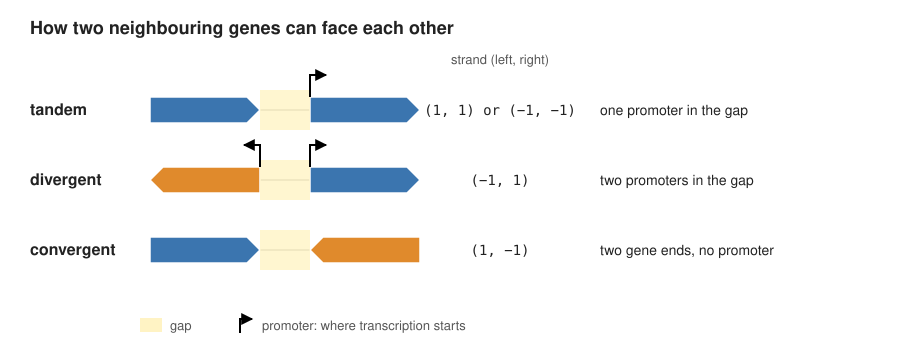

```{css, echo=FALSE}
/* Answers are white on white: select them with the mouse to read them */
.answer, .answer * { color: white !important; background: white !important;
                     border-color: white !important; box-shadow: none !important; }
.answer ::selection, .answer::selection { background: #b3d4fc !important; color: black !important; }
```

# Learning Outcomes

- Develop reproducible computational procedures using R notebooks.
- Work with Conda environments.
- Run sequence processing software via command-line interfaces.
- Analyse and plot the results in R.

---

## ⚠️ IMPORTANT NOTICE
> **PLEASE READ THE TEXT AND INSTRUCTIONS CAREFULLY — DO NOT JUST BLINDLY COPY-PASTE COMMANDS.**
> Each command has a purpose. Understanding *why* you are running it is part of learning reproducible research.

---

# Initial setup: Work environment and data

The starter notebook contains the instructions below for setting up
your project and Conda environment. You download it in the first steps
and then work in it: copy the code from this page into the notebook and
write your answers there. You can also download a copy from
**[rresearch_notebook.Rmd](rresearch_notebook.Rmd)**.
The notebook will serve as both a simple pipeline and a final
(reproducible) report.



You will use **two jobs** on CREATE:

1. a **terminal** on a compute node (`srun`) to set up the project
   folder, the data and Conda;
2. **RStudio** (`sbatch`) to work in the notebook.

You can run at most **2 jobs at the same time**, so these two are all
you need. Stop them when you have finished (see the end of this
page).

## Log in to CREATE

Open a terminal on your laptop: **Terminal** on macOS/Linux,
**PowerShell** on Windows. Connect to CREATE with `ssh`, using your own
k-number:

```{bash, eval=FALSE}
ssh k1234567@hpc.create.kcl.ac.uk
```

## Terminal on a compute node

You are now on a **login node** (the prompt shows `erc-hpc-login...`).
Login nodes are only for submitting jobs, and Conda is not available
there. Move to a compute node by running interactive job with `srun`:

```{bash, eval=FALSE}
srun -p msc_appbio --mem=4G --time=02:00:00 --pty bash -l
```

The prompt changes from `erc-hpc-login...` to a compute node name.
Run all commands in this section in this terminal. If `srun` just
waits and nothing happens, see [Troubleshooting](#troubleshooting).

## Directory and data setup

**Create a project folder and fetch the starter notebook**

```{bash, eval=FALSE}
mkdir yeast_project
cd yeast_project
wget https://raw.githubusercontent.com/zelezniak-lab/7BBG1002/refs/heads/main/rres/rresearch_notebook.Rmd
```

Now fetch the data we will be using, both from Ensembl release 113 for
the yeast *Saccharomyces cerevisiae*: the coding sequences (CDS) of all
protein-coding genes, and the genome (all chromosomes):

```{bash, eval=FALSE}
mkdir data results
wget -O data/yeast_cds.fa.gz https://ftp.ensembl.org/pub/release-113/fasta/saccharomyces_cerevisiae/cds/Saccharomyces_cerevisiae.R64-1-1.cds.all.fa.gz
wget -O data/yeast_genome.fa.gz https://ftp.ensembl.org/pub/release-113/fasta/saccharomyces_cerevisiae/dna/Saccharomyces_cerevisiae.R64-1-1.dna.toplevel.fa.gz
ls -l data
```

To make sure this data is protected from accidental writes, remove the
write permission (`-w`) for everyone (`ugo`):

```{bash, eval=FALSE}
chmod ugo-w data/*.fa.gz
```

## Work environment

It's standard practice to create a new conda environment for each project.
This is because each project may require a number of different software packages,
with certain version. Even if these requirements are very similar between the projects,
even small differences may topple the house of cards that is the software ecosystem.
This is officially referred to as ["dependency hell"](https://en.wikipedia.org/wiki/Dependency_hell)
and can be traumatizing.

**Load Conda.** Software on CREATE comes as **modules**. Load the
Conda module, then connect Conda to your shell so that
`conda activate` works:

```{bash, eval=FALSE}
module load anaconda3/2025.12-2
eval "$(conda shell.bash hook)"
conda --version
```

Your prompt now starts with `(base)`. You need these two lines again in
every new terminal. Do **not** run `conda init`, even if an error
message suggests it.

**Accept the Anaconda terms of service.** You only do this once:

```{bash, eval=FALSE}
conda tos accept --override-channels --channel https://repo.anaconda.com/pkgs/main
conda tos accept --override-channels --channel https://repo.anaconda.com/pkgs/r
```

Conda can fetch packages from many different sources (aka "channels").
Let's add the Bioconda channel, as well as the general-purpose conda-forge:

```{bash, eval=FALSE}
conda config --add channels bioconda
conda config --add channels conda-forge
```

Create a new environment for this exercise. The `conda create` command
creates new environments, the option `--name` specifies the name of your
new environment and the option `-y` lets conda know that you answer yes
to all prompts.

```{bash, eval=FALSE}
conda create --name yeast-tools -y
```

Now activate it. Your prompt changes to `(yeast-tools)`:

```{bash, eval=FALSE}
conda activate yeast-tools
```

If that doesn't work, please ask for help so we make sure we all start
from the same place.

Now install the software needed for this exercise, SeqKit, into the
active environment. We pin the version (`=2.9.0`) so that anyone
repeating the work gets the same one:

```{bash, eval=FALSE}
conda install seqkit=2.9.0 -y
```

Let's inspect the packages that we just installed:

```{bash, eval=FALSE}
conda list
```

Save the software you installed, so anyone can rebuild the same
environment with `conda env create -f environment.yml`:

```{bash, eval=FALSE}
conda env export --from-history > environment.yml
cat environment.yml
```

## Start RStudio

Now start RStudio with `sbatch`, following
**[these instructions](../create/rstudio_create.html)**.

In RStudio, make the folder an **RStudio Project**: **File → New
Project → Existing Directory**, choose `yeast_project`, and click
**Create Project**. R now works inside this folder, so all paths in
this notebook are short and relative (`data/...`, `results/...`).
**Don't use `setwd()`**: a path like `/users/k1234567/...` works only
for you. Next time, open the project with **File → Open Project**.

Open `rresearch_notebook.Rmd` from the Files pane and continue there.
From now on, run the code chunks in the notebook (green arrow).

**Tell the notebook where SeqKit is.** Conda installed the environment
in `~/.conda/envs/yeast-tools`, and its programs are in the `bin`
folder there. The last chunk of the notebook loads the `tidyverse`
package and adds that folder to `PATH`, so every `bash` chunk can find
`seqkit` without loading Conda again. Run it now, and again whenever
you restart R:

```{r setup, eval=FALSE}
library(tidyverse)
Sys.setenv(PATH = paste(path.expand("~/.conda/envs/yeast-tools/bin"),
                        Sys.getenv("PATH"), sep = ":"))
```

From here on, copy each code chunk on this page, including the
`{bash}` or `{r}` line and the closing backticks, into your notebook
and run it there. Write your answers to the questions in the notebook.

# Exercise 1: Inspect the sequences

`zcat` decompresses the file and prints the text. The pipe `|` sends
that text to the next command. `head` shows the first 10 lines.

````markdown
`r ''````{bash}
zcat data/yeast_cds.fa.gz | head
```
````

In FASTA, each sequence starts with a header line beginning with `>`.
Count those header lines:

````markdown
`r ''````{bash}
zcat data/yeast_cds.fa.gz | grep -c '^>'
```
````

## Question

How many sequence records are there? Why would counting all the lines
give a different answer?

Answer:

::: {.answer}
There are 6,600 records (6,600 genes). Counting all lines gives
155,818, because each sequence is split over many lines, and only the
header line starts with `>`.
:::

# Exercise 2: Process the sequences with SeqKit

### Step 1: Summarise the FASTA files

````markdown
`r ''````{bash}
seqkit stats data/yeast_cds.fa.gz data/yeast_genome.fa.gz
```
````

### Step 2: A table of genes

We want a table with one row per gene: its ID, chromosome, start, end,
strand and length. Most of this is already in the FASTA headers, and
standard Unix tools are all we need to get it out. Save all headers to
a file first: `grep '>'` keeps only the lines that contain `>`.

````markdown
`r ''````{bash}
zcat data/yeast_cds.fa.gz | grep '>' > results/cds_headers.txt
wc -l results/cds_headers.txt
head -n 3 results/cds_headers.txt
```
````

Each header is a list of fields separated by spaces: the record ID,
`cds`, the position (`chromosome:R64-1-1:XVI:420048:420518:-1`), the
gene name and a long description. We build the command one tool at a
time, and try each version on the first three headers before running
it on all of them.



`cut` keeps selected fields: `-d ' '` says that fields are separated by
spaces, and `-f 1,3` keeps fields 1 and 3, the ID and the position:

````markdown
`r ''````{bash}
head -n 3 results/cds_headers.txt | cut -d ' ' -f 1,3
```
````

`sed 's/old/new/'` replaces text. Each `-e` adds one replacement; an
empty `new` removes the text. Remove the `>`, the `_mRNA` suffix and
the `chromosome:R64-1-1:` label, which is the same in every header:

````markdown
`r ''````{bash}
head -n 3 results/cds_headers.txt | cut -d ' ' -f 1,3 | sed -e 's/>//' -e 's/_mRNA//' -e 's/chromosome:R64-1-1://'
```
````

Finally, turn every space and `:` into a tab (`\t`), so that each value
gets its own column. `[ :]` means "a space or a colon" and `g` at the
end replaces all of them, not only the first:

````markdown
`r ''````{bash}
head -n 3 results/cds_headers.txt | cut -d ' ' -f 1,3 | sed -e 's/>//' -e 's/_mRNA//' -e 's/chromosome:R64-1-1://' -e 's/[ :]/\t/g'
```
````

It works, so run it on all headers and save the result:

````markdown
`r ''````{bash}
cut -d ' ' -f 1,3 results/cds_headers.txt | sed -e 's/>//' -e 's/_mRNA//' -e 's/chromosome:R64-1-1://' -e 's/[ :]/\t/g' > results/positions.tsv
wc -l results/positions.tsv
```
````

The CDS length is not in the header: we have to count the letters of
each sequence, which is spread over many lines. This is where SeqKit
helps. `seqkit fx2tab` writes one row per sequence: `-n` leaves out the
sequence itself, `-i` keeps only the ID and `-l` adds the length:

````markdown
`r ''````{bash}
seqkit fx2tab -n -i -l data/yeast_cds.fa.gz > results/lengths.tsv
head -n 3 results/lengths.tsv
```
````

Both files list the genes in the same order, so `paste` can put them
side by side. Check that the IDs in columns 1 and 6 match:

````markdown
`r ''````{bash}
paste results/positions.tsv results/lengths.tsv | head -n 3
```
````

Save the final table: `printf` writes the column names first (`\n` is a
new line); `>` creates the file and `>>` appends to it. `cut -f 1-5,7`
leaves out the repeated ID in column 6:

````markdown
`r ''````{bash}
printf 'record_id\tchromosome\tstart\tend\tstrand\tlength_bp\n' > results/yeast_cds.tsv
paste results/positions.tsv results/lengths.tsv | cut -f 1-5,7 >> results/yeast_cds.tsv
head results/yeast_cds.tsv
```
````

**The same table with SeqKit.** Specialised tools such as SeqKit
understand the FASTA format, so they can do the whole job in one
pipeline, with no temporary files and no `paste`. `seqkit replace`
edits the headers: `-p` gives a pattern to find and `-r` its
replacement. `(\S+)` captures the position (everything up to the next
space) and `.*` matches the rest of the header, so each header becomes
`YPL071C XVI:420048:420518:-1`. `seqkit fx2tab -n -l` then prints each
header with the sequence length, and `tr ' :' '\t\t'` turns spaces and
colons into tabs:

````markdown
`r ''````{bash}
printf 'record_id\tchromosome\tstart\tend\tstrand\tlength_bp\n' > results/yeast_cds_seqkit.tsv
seqkit replace -p '_mRNA cds chromosome:R64-1-1:(\S+) .*' -r ' $1' data/yeast_cds.fa.gz | seqkit fx2tab -n -l | tr ' :' '\t\t' >> results/yeast_cds_seqkit.tsv
head -n 3 results/yeast_cds_seqkit.tsv
diff results/yeast_cds.tsv results/yeast_cds_seqkit.tsv && echo "Both tables are the same"
```
````

### Step 3: A table of chromosomes

Look at the headers of the genome file. There are only 17:

````markdown
`r ''````{bash}
zcat data/yeast_genome.fa.gz | grep '>'
```
````

Here the header already contains the chromosome length: it is the end
position, `230218` for chromosome I. Split at `:` instead of spaces
and keep fields 4 (the name) and 6 (the end):

````markdown
`r ''````{bash}
zcat data/yeast_genome.fa.gz | grep '>' | cut -d ':' -f 4,6
```
````

Replace the `:` with a tab and save the table:

````markdown
`r ''````{bash}
printf 'chromosome\tchromosome_bp\n' > results/chromosomes.tsv
zcat data/yeast_genome.fa.gz | grep '>' | cut -d ':' -f 4,6 | sed 's/:/\t/' >> results/chromosomes.tsv
cat results/chromosomes.tsv
```
````

Can we trust the header? Count the real sequence lengths with SeqKit
and compare:

````markdown
`r ''````{bash}
seqkit fx2tab -n -i -l data/yeast_genome.fa.gz
```
````

## Questions

How many genes and how many chromosomes are there? What are the
shortest, longest and average CDS lengths? One "chromosome" is called
`Mito`: what is it?

Do the chromosome lengths in the headers agree with the lengths counted
by SeqKit? Why is it worth checking?

Answer:

::: {.answer}
6,600 genes and 17 chromosomes (16 nuclear + `Mito`). CDS length:
shortest 51 bp, longest 14,733 bp (YLR106C, MDN1), average 1,327.6 bp
(from `seqkit stats -a` or `summary(genes$length_bp)` in Exercise 3).
`Mito` is the mitochondrial genome (85,779 bp, 28 CDS).

Yes, the header lengths and the SeqKit lengths are the same for all 17
chromosomes. A header is only text that someone wrote; the sequence
is the data. Checking catches mistakes such as a truncated download, a
wrong or edited header, or a different genome version.
:::

# Exercise 3: Genes and chromosomes in R

Read the gene table you made in Exercise 2:

````markdown
`r ''````{r}
genes <- read_tsv("results/yeast_cds.tsv", show_col_types = FALSE)
head(genes)
nrow(genes)
```
````

Check that the row count matches your record count from Exercise 1.

Calculate a summary. `%>%` passes the data to the next operation,
`summarise()` calculates summary values and `write_tsv()` saves the
result:

````markdown
`r ''````{r}
genes_summary <- genes %>%
  summarise(genes = n(),
            mean_length = mean(length_bp),
            median_length = median(length_bp))
genes_summary
write_tsv(genes_summary, "results/summary.tsv")
```
````

Now count the genes on each chromosome with `count()`, and add them to
the chromosome table with `left_join()`, which matches rows by the
`chromosome` column. Gene density is the number of genes per 100,000 bp
(100 kb):



````markdown
`r ''````{r}
chromosomes <- read_tsv("results/chromosomes.tsv", show_col_types = FALSE) %>%
  left_join(count(genes, chromosome, name = "genes"), by = "chromosome") %>%
  mutate(genes_per_100kb = genes / chromosome_bp * 100000)
chromosomes
write_tsv(chromosomes, "results/chromosomes_genes.tsv")
```
````

Select and sort rows. `filter()` selects rows, `arrange()` sorts them
and `desc()` puts the largest first:

````markdown
`r ''````{r}
chromosomes %>%
  filter(chromosome_bp > 1000000) %>%
  arrange(desc(genes))
```
````

## Questions

Are mean and median CDS length similar? What could explain a
difference?

For most genes, `end - start + 1` equals `length_bp`, but not for all.
Use `filter()` to find the genes where they differ. How many are there,
and why is the gene longer on the chromosome than its CDS?

Which chromosome has the most genes? Is it also the longest? Which
chromosome has the highest and which the lowest gene density?

Change the example above to list the genes on `Mito`, from longest to
shortest.

Answer:

::: {.answer}
Mean 1,328 bp, median 1,062 bp. The mean is larger because the
distribution is skewed to the right: a few very long genes (up to
14,733 bp) pull the mean up, while the median is not affected by them.

`genes %>% filter(end - start + 1 != length_bp)` gives 287 genes. The
CDS contains only the coding exons, but `start`–`end` on the chromosome
also spans the **introns** between them (276 nuclear genes with
introns, and 11 mitochondrial genes such as COX1, which has many
introns).

Chromosome IV has the most genes (836) and is also the longest
(1.53 Mb). Highest density: III (58.1 per 100 kb); lowest: `Mito`
(32.6), and among the nuclear chromosomes I (50.8).

`genes %>% filter(chromosome == "Mito") %>% arrange(desc(length_bp))`
(28 genes; the longest is Q0055, 2,565 bp).
:::

````markdown
`r ''````{r}
# Write your code here.
```
````

# Exercise 4: Strands, gaps and overlaps

DNA has two strands, and a gene can be on either of them. The `strand`
column is `1` for the + strand and `-1` for the − strand. Count the
genes on each strand:

````markdown
`r ''````{r}
count(genes, strand)
```
````

Next, compare each gene with its **neighbour**, the gene just to its
left on the same chromosome. The **gap** is the DNA between the two
genes. If it is negative, the two genes overlap:



Two neighbours can face each other in three ways. The space between
them holds the start of transcription (the **promoter**) of a gene that
points away from the gap:



`arrange()` sorts the genes by position, and `group_by(chromosome)`
makes sure that we only compare genes on the same chromosome. `lag()`
takes the value from the previous row, which is the left neighbour, and
`case_when()` names the orientation from the two strands. The first
gene on each chromosome has no left neighbour, so `filter()` removes
it:

````markdown
`r ''````{r}
neighbours <- genes %>%
  arrange(chromosome, start) %>%
  group_by(chromosome) %>%
  mutate(gap_bp = start - lag(end) - 1,
         orientation = case_when(lag(strand) == strand ~ "tandem",
                                 lag(strand) == -1 ~ "divergent",
                                 lag(strand) == 1 ~ "convergent")) %>%
  ungroup() %>%
  filter(!is.na(gap_bp))
head(neighbours)
```
````

Summarise each orientation: how many pairs, the median gap and how many
pairs overlap. `sum(gap_bp < 0)` counts the rows where the condition is
`TRUE`:

````markdown
`r ''````{r}
orientation_summary <- neighbours %>%
  group_by(orientation) %>%
  summarise(pairs = n(),
            median_gap = median(gap_bp),
            overlapping = sum(gap_bp < 0))
orientation_summary
write_tsv(orientation_summary, "results/orientations.tsv")
```
````

## Questions

Are genes spread evenly over the two strands?

How many neighbouring genes overlap in total? Are overlapping genes
mostly on the same strand or on opposite strands?

Which orientation has the longest gaps and which the shortest? Use the
second scheme to explain why.

Answer:

::: {.answer}
Yes, almost: 3,331 genes on the + strand and 3,269 on the − strand.

646 neighbouring pairs overlap. Most are on opposite strands
(229 convergent + 302 divergent = 531), only 115 on the same strand
(tandem).

Convergent pairs have the shortest gaps (median 206 bp), divergent
(379 bp) and tandem (380 bp) are longer. Between two convergent genes
there is no promoter, only the two gene ends. Divergent gaps hold the
promoters of both genes and tandem gaps the promoter of one gene, so
they need more space. (Divergent pairs overlap most often, which pulls
their median down; without overlaps divergent gaps are the longest,
see Exercise 5.)
:::

# Exercise 5: Make figures with ggplot2

Plot the CDS length distribution and save it:

````markdown
`r ''````{r}
p_length <- ggplot(genes, aes(x = length_bp)) +
  geom_histogram(bins = 40, fill = "steelblue", colour = "white") +
  labs(x = "CDS length (bp)", y = "Number of genes") +
  theme_minimal()
p_length
ggsave("results/lengths.png", p_length, width = 8, height = 5)
```
````

Compare chromosome length and number of genes. Each point is one
chromosome; `geom_text_repel()` from the `ggrepel` package labels the
points without overlapping:

````markdown
`r ''````{r}
library(ggrepel)
p_chrom <- ggplot(chromosomes, aes(x = chromosome_bp / 1000000, y = genes,
                                   label = chromosome)) +
  geom_point() +
  geom_text_repel() +
  labs(x = "Chromosome length (Mb)", y = "Number of genes") +
  theme_minimal()
p_chrom
ggsave("results/chromosome_genes.png", p_chrom, width = 8, height = 5)
```
````

Plot the gaps between neighbouring genes. The red line marks 0: bars
to its left are overlapping genes. `coord_cartesian()` zooms in on gaps
between −1,000 and 3,000 bp:

````markdown
`r ''````{r}
p_gaps <- ggplot(neighbours, aes(x = gap_bp)) +
  geom_histogram(binwidth = 50, fill = "steelblue", colour = "white") +
  geom_vline(xintercept = 0, colour = "red") +
  coord_cartesian(xlim = c(-1000, 3000)) +
  labs(x = "Gap between neighbouring genes (bp)", y = "Number of gene pairs") +
  theme_minimal()
p_gaps
ggsave("results/gaps.png", p_gaps, width = 8, height = 5)
```
````

Compare the gaps for the three orientations. We leave out overlapping
pairs and use a log scale, because a few gaps are very long:

````markdown
`r ''````{r}
p_orient <- ggplot(filter(neighbours, gap_bp > 0),
                   aes(x = orientation, y = gap_bp, fill = orientation)) +
  geom_boxplot(outlier.alpha = 0.2) +
  scale_y_log10() +
  labs(x = NULL, y = "Gap between neighbouring genes (bp)") +
  theme_minimal() +
  theme(legend.position = "none")
p_orient
ggsave("results/orientation_gaps.png", p_orient, width = 6, height = 5)
```
````

## Questions

What relationship do you see between chromosome length and number of
genes? Roughly how many genes are there per 100 kb? Which point does
not follow the pattern, and why might that be?

Make a bar plot of the gene density of each chromosome with
`geom_col()` (x = `chromosome`, y = `genes_per_100kb`), and save it
under a different file name.

What is the most common gap size? Does the boxplot agree with your
answer about orientations in Exercise 4?

The human genome is about 3,100 Mb long and has about 20,000
protein-coding genes. Calculate its gene density in genes per 100 kb
and compare it with yeast. What does this tell you about the human
genome?

Answer:

::: {.answer}
Number of genes increases almost linearly with chromosome length,
about 54 genes per 100 kb (one gene every ~1.8 kb). `Mito` does not
follow the pattern: it has far fewer genes for its length (32.6 per
100 kb), because the mitochondrial genome is a separate genome with
long introns, rRNA and tRNA genes and AT-rich non-coding DNA.

```r
p_density <- ggplot(chromosomes, aes(x = chromosome, y = genes_per_100kb)) +
  geom_col(fill = "steelblue") +
  labs(x = "Chromosome", y = "Genes per 100 kb") +
  theme_minimal()
ggsave("results/gene_density.png", p_density, width = 8, height = 5)
```

The most common gaps are about 200–300 bp (highest bar 250–300 bp).
Yes, and it shows it more clearly: without the overlapping pairs,
convergent gaps are shortest (median 236 bp), tandem longer (391 bp)
and divergent longest (486 bp), which fits two promoters > one
promoter > no promoter.

Human: 20,000 / 3,100,000,000 × 100,000 ≈ 0.65 genes per 100 kb,
about 80 times fewer than yeast (54). Most of the human genome does
not code for proteins: large introns, intergenic regions and
repeats.
:::

````markdown
`r ''````{r}
# Write your code here.
```
````

# Finish: knit

Now click **Knit**. Knit starts a fresh R session, so every piece of
code the report needs must be in the notebook, not only typed in the
Console or Terminal.

## Question

Which files would you give a classmate so they can repeat your work
from scratch? Which files do they *not* need, because they can recreate
them?

Answer:

::: {.answer}
Give them `rresearch_notebook.Rmd` (the code and text) and the
software information (Conda environment: SeqKit 2.9.0, and R packages,
see `sessionInfo()`). The data in `data/` can be downloaded again with
the commands in the notebook, so they need the data only if the download
links may change. They do not need `results/` or the knitted HTML: the
notebook recreates them.
:::

When you have finished, type `exit` in your `srun` terminal and stop
your RStudio job with `scancel` (see the
[RStudio instructions](../create/rstudio_create.html)).

# Homework

1.  Find the ten longest genes with `arrange()` and
    `slice_head(n = 10)`, and save the table in `results`. Which
    chromosomes are they on?
2.  Find the overlapping gene pairs (`gap_bp < 0`) and make a bar plot
    of how many there are for each orientation with `geom_bar()`. Which
    orientation overlaps most often? Look up two of the overlapping
    genes on the [Saccharomyces Genome Database](https://www.yeastgenome.org):
    are they well-studied genes?
3.  Write a short paragraph describing how genes are arranged on yeast
    chromosomes: gene density, strands, gaps and overlaps, and how the
    human genome differs. Why does a pattern in a plot not establish
    cause and effect?

````markdown
`r ''````{r}
# Write your code here.
```
````

Restart R with **Session → Restart R**, then Knit again and submit your
`rresearch_notebook.Rmd` and `rresearch_notebook.html`.

````markdown
`r ''````{r}
sessionInfo()
```
````

# Troubleshooting

If a command fails, stop at that step and ask for help. Common problems:

-   **`srun` or RStudio waits and nothing happens** (`queued and waiting
    for resources`): you already have 2 jobs running, often an old
    RStudio job you forgot to stop. On the login node, list your jobs:

    ```{bash, eval=FALSE}
    squeue -u $USER
    ```

    Each line is one job. `R` in the `ST` column means running, `PD`
    means waiting. Stop the job you no longer need with its number from
    the `JOBID` column:

    ```{bash, eval=FALSE}
    scancel 12345678    # use your own job number
    ```

    Then run `srun` (or `sbatch`) again.
-   **You need another terminal, but you already have 2 jobs**: open
    a terminal on the node where your RStudio job runs instead of
    starting a new job. On the login node, find the RStudio job number
    (the `JOBID` column) and join that job:

    ```{bash, eval=FALSE}
    squeue -u $USER
    srun --jobid=12345678 --overlap --pty bash -l    # use your RStudio job number
    ```

    This does not count as a new job. It shares the CPUs, memory and
    time limit of your RStudio job, so use it only for light work
    (looking at files, short commands): if together they use more
    memory than the job has, the RStudio job can be stopped. The
    **Terminal** tab in RStudio is on the same node too.
-   **`module: command not found` or `conda: command not found`**: you
    are probably still on the login node (prompt `erc-hpc-login...`).
    Run the `srun` command first, then `module load` and
    `eval "$(conda shell.bash hook)"`.
-   **`conda activate` fails and asks you to run `conda init`**: don't.
    Run `eval "$(conda shell.bash hook)"` and try again.
-   **`seqkit: command not found` in a notebook chunk**: run the
    `Sys.setenv(PATH = ...)` chunk in [Start RStudio](#start-rstudio)
    first. If it still fails, check in the `srun` terminal that SeqKit
    is installed: `conda activate yeast-tools` then `conda list seqkit`.
-   **The `srun` terminal closed** (time limit, lost connection): log in
    and run `srun` again, then `cd yeast_project` and, if you need
    Conda, the `module load` and `eval` lines again.
-   **RStudio page does not load**: check that your RStudio job is still
    running with `squeue -u $USER`, and follow the
    [RStudio instructions](../create/rstudio_create.html) again.
-   **Knit reports an error in your own code**: fix that chunk and try
    again.
